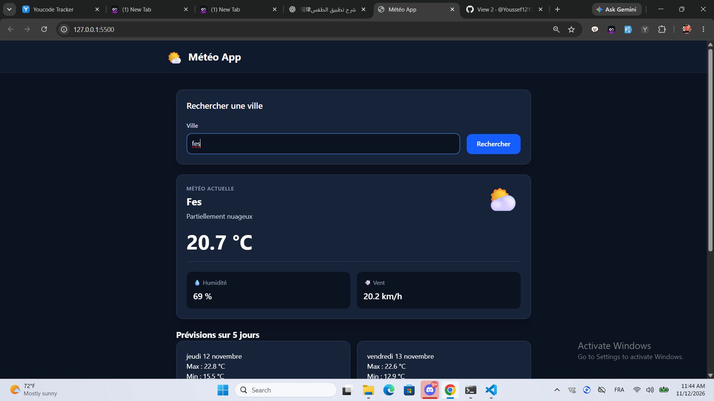
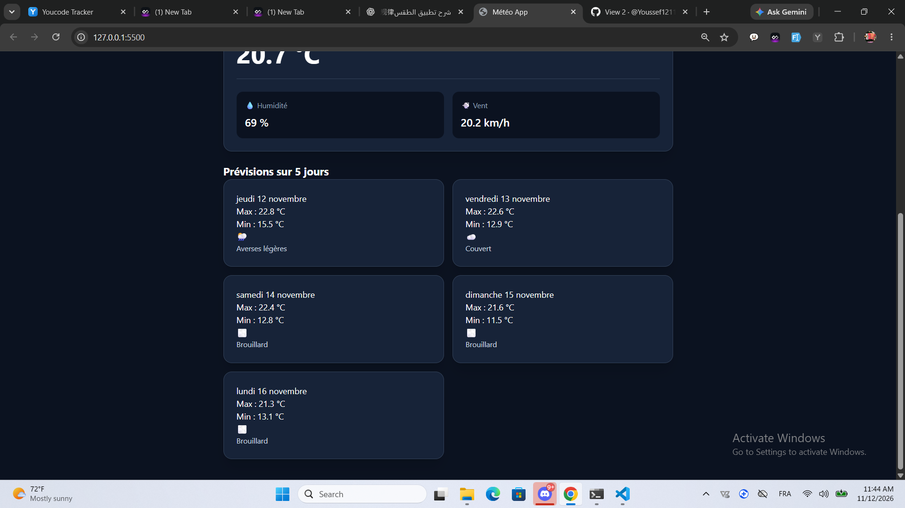
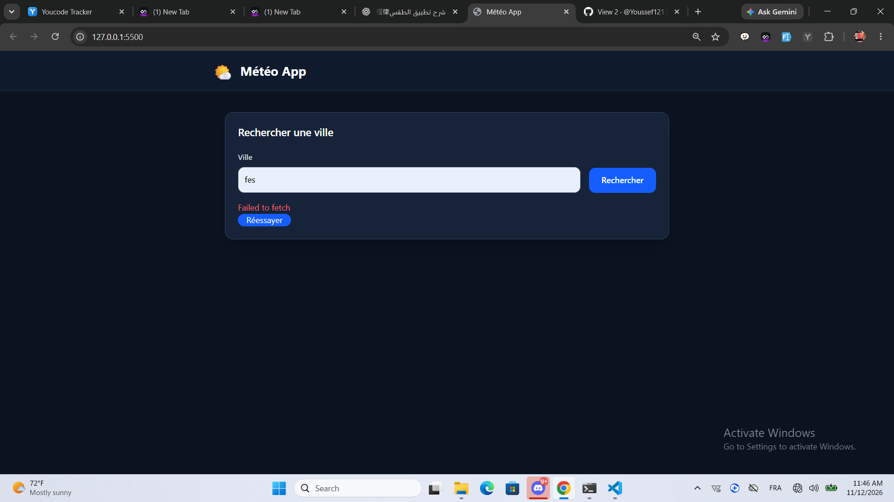

# B6-Application-m-t-o


# 🌤️ Météo App

## Description

Météo App est une application web qui permet de rechercher une ville et de consulter sa météo actuelle ainsi que les prévisions des 5 prochains jours.

L'application utilise les API Open-Meteo pour récupérer les coordonnées géographiques et les données météorologiques.

## Technologies utilisées

- HTML5
- Tailwind CSS v4
- JavaScript
- Open-Meteo API

## Installation et lancement

1. Cloner le dépôt GitHub.
2. Ouvrir le dossier du projet dans VS Code.
3. Installer les dépendances avec `npm install` (si le projet contient un `package.json`).
4. Si nécessaire, générer le CSS avec :

   `npx @tailwindcss/cli -i ./src/input.css -o ./dist/output.css --watch`

5. Ouvrir `index.html` avec Live Server.

Une connexion Internet est nécessaire pour récupérer les données météorologiques.


## Installation et lancement

1. Cloner le dépôt GitHub.
2. Ouvrir le projet dans VS Code.
3. Installer les dépendances :

   npm install

4. Générer le CSS avec Tailwind :

   npx @tailwindcss/cli -i ./src/input.css -o ./dist/output.css --watch

5. Ouvrir index.html avec Live Server.


## API utilisées

L'application utilise deux API gratuites d'Open-Meteo.

### 1. Geocoding API

**Endpoint :**

`https://geocoding-api.open-meteo.com/v1/search`

**Paramètres :**

| Paramètre | Description |
|---|---|
| `name` | Nom de la ville recherchée |
| `count=1` | Retourne une seule ville |

Cette API permet de récupérer le nom, la latitude et la longitude de la ville.

### 2. Forecast API

**Endpoint :**

`https://api.open-meteo.com/v1/forecast`

**Paramètres :**

| Paramètre | Description |
|---|---|
| `latitude` | Latitude de la ville |
| `longitude` | Longitude de la ville |
| `current` | Température, humidité, vent et code météo |
| `daily` | Températures minimales, maximales et codes météo |
| `timezone=auto` | Fuseau horaire automatique |
| `forecast_days=5` | Prévisions sur 5 jours |

L'application récupère les données avec `fetch()` et les affiche dynamiquement avec JavaScript.


## Exemple de réponse JSON

Voici un exemple simplifié de réponse de l'API Forecast (données fictives) :

```json
{
  "current": {
    "temperature_2m": 22,
    "relative_humidity_2m": 65,
    "wind_speed_10m": 12,
    "weather_code": 1
  },
  "daily": {
    "time": ["2026-11-12", "2026-11-13"],
    "temperature_2m_max": [25, 24],
    "temperature_2m_min": [15, 14],
    "weather_code": [1, 3]
  }
}
```

### Affichage des données

- `temperature_2m` : température actuelle affichée en °C.
- `relative_humidity_2m` : humidité affichée en %.
- `wind_speed_10m` : vitesse du vent affichée en km/h.
- `weather_code` : converti en description et en icône météo.
- `time` : dates affichées en français.
- `temperature_2m_max` : températures maximales des jours.
- `temperature_2m_min` : températures minimales des jours.

Les tableaux de `daily` sont parcourus avec `forEach()` et reliés grâce à leur index.


## Limites de l'API

Open-Meteo propose un accès gratuit pour une utilisation non commerciale, sous certaines limites.

- **Quota :** l'API limite le nombre de requêtes autorisées.
- **Données disponibles :** les prévisions dépendent des modèles météorologiques et peuvent évoluer.
- **Erreur 429 :** l'application affiche un message lorsque la limite de requêtes est atteinte.

### Respect des limites

- Les requêtes sont envoyées uniquement lors d'une recherche.
- `count=1` limite la recherche à une ville.
- `forecast_days=5` limite les prévisions à cinq jours.
- L'application demande uniquement les données nécessaires : température, humidité, vent et conditions météo.


## Captures d'écran

### Météo actuelle



### Prévisions sur 5 jours



### Gestion des erreurs




## Journal des tests manuels

| Test | Résultat attendu | Statut |
|---|---|---|
| Recherche d'une ville valide | Affichage de la météo actuelle | OK |
| Prévisions sur 5 jours | Affichage des 5 cartes météo | OK |
| Ville inconnue | Message « Ville introuvable » | OK |
| Connexion Internet coupée | Affichage d'un message d'erreur | OK |
| Quota 429 simulé | Message « Quota atteint » | OK |
| Erreur API simulée | Affichage d'un message d'erreur | OK |
| Bouton Réessayer | Relance la dernière recherche | OK |